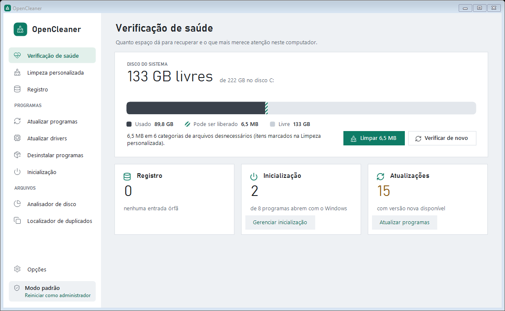
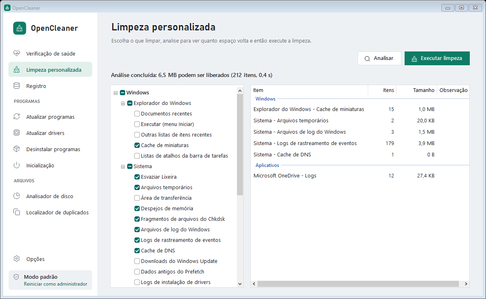
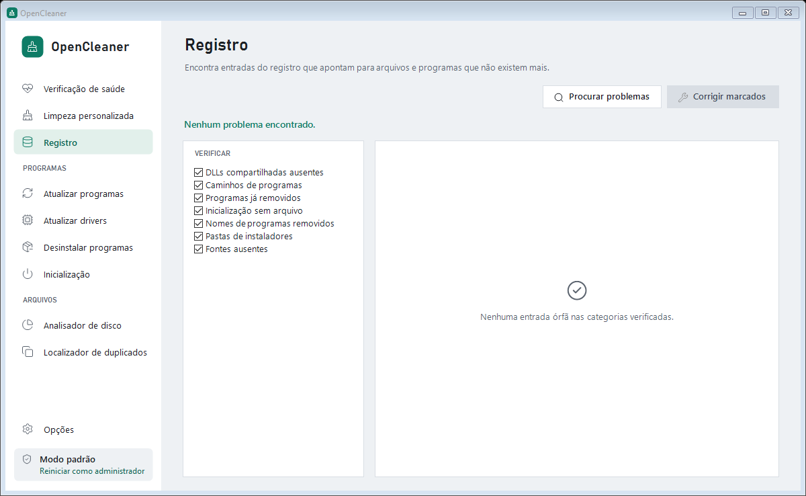
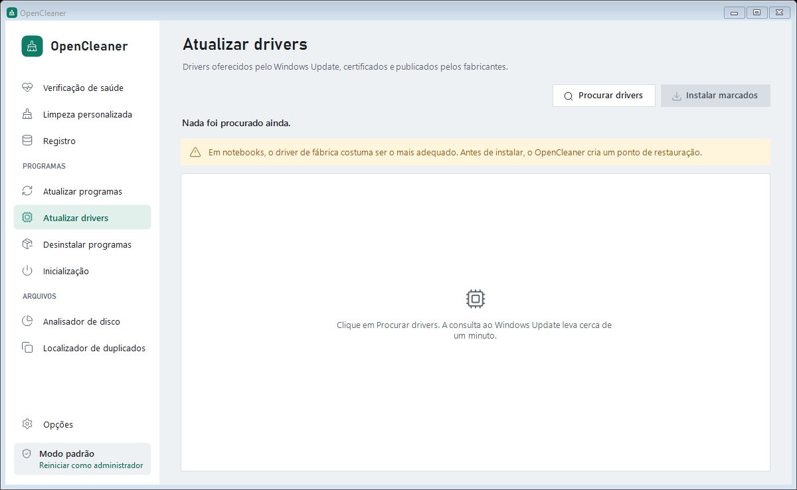

<div align="center">


# OpenCleaner

**Limpador de PC gratuito e de código aberto para Windows.**
Libera espaço em disco, limpa navegadores, corrige o registro, atualiza programas e drivers e
gerencia a inicialização, sem telemetria, sem anúncios e sem versão paga.

[](https://github.com/flavioricardo/OpenCleaner/releases/latest)
[](https://github.com/flavioricardo/OpenCleaner/releases)
[](https://github.com/flavioricardo/OpenCleaner/actions/workflows/build.yml)
[](LICENSE)


### [⬇ Baixar o instalador](https://github.com/flavioricardo/OpenCleaner/releases/latest/download/OpenCleaner-Setup.exe) · [Versão portátil (.zip)](https://github.com/flavioricardo/OpenCleaner/releases/latest/download/OpenCleaner-portable.zip) · [Todas as versões](https://github.com/flavioricardo/OpenCleaner/releases)



[English summary](#english) · [Recursos](#o-que-o-opencleaner-faz) · [Permissões](#permissões-e-privacidade) · [Perguntas frequentes](#perguntas-frequentes)

</div>

---

## Sumário

- [Por que o OpenCleaner](#por-que-o-opencleaner)
- [Baixar e instalar](#baixar-e-instalar)
- [O que o OpenCleaner faz](#o-que-o-opencleaner-faz)
- [O que cada ação altera](#o-que-cada-ação-altera)
- [Permissões e privacidade](#permissões-e-privacidade)
- [Proteções contra estragos](#proteções-contra-estragos)
- [Linha de comando e limpeza automática](#linha-de-comando-e-limpeza-automática)
- [Perguntas frequentes](#perguntas-frequentes)
- [Inspirações e créditos](#inspirações-e-créditos)
- [Compilar a partir do código](#compilar-a-partir-do-código)
- [Contribuir](#contribuir)
- [Licença](#licença)
- [English](#english)

## Por que o OpenCleaner

Limpadores de PC populares viraram vitrines de assinatura: avisos de "problemas encontrados" para
vender a versão paga, telemetria ligada por padrão, ofertas de outros produtos durante a instalação.
O OpenCleaner faz o trabalho de um limpador de sistema completo e para por aí:

- **Gratuito de verdade**: nenhum recurso bloqueado, nenhuma assinatura.
- **Em português e em inglês**: o app e o instalador seguem o idioma do Windows, e dá para trocar a qualquer momento.
- **Sem telemetria**: o app não envia nada sobre você nem sobre o seu PC.
- **Transparente**: o código está aqui, e cada item de limpeza mostra exatamente quais arquivos sairão.
- **Leve**: um único executável de cerca de 230 KB, sem serviço em segundo plano e sem iniciar com o Windows.
- **Cuidadoso**: analisar nunca apaga nada; o que é destrutivo pede confirmação; senhas e cookies vêm desmarcados.

## Baixar e instalar

| Arquivo | Para quem |
|---|---|
| **[OpenCleaner-Setup.exe](https://github.com/flavioricardo/OpenCleaner/releases/latest/download/OpenCleaner-Setup.exe)** | Recomendado. Instala só para o seu usuário, **sem pedir permissão de administrador**, com atalho no menu Iniciar e desinstalação em *Configurações > Apps*. |
| [OpenCleaner-portable.zip](https://github.com/flavioricardo/OpenCleaner/releases/latest/download/OpenCleaner-portable.zip) | Portátil: extraia e abra o `OpenCleaner.exe`. Bom para pendrive ou para testar sem instalar. |

**Requisitos:** Windows 10 ou Windows 11, 32 ou 64 bits. O .NET Framework 4.x necessário já vem
com o Windows. O atualizador de programas usa o [winget](https://learn.microsoft.com/windows/package-manager/winget/)
(já incluído no Windows 11 e nas versões atuais do Windows 10).

**"O Windows protegeu o computador":** o instalador ainda não tem assinatura digital paga, então o
SmartScreen pode avisar na primeira execução. Clique em **Mais informações** > **Executar assim mesmo**.
Para conferir que o arquivo é o publicado aqui, compare o SHA-256 com o `SHA256SUMS.txt` da release:

```powershell
Get-FileHash .\OpenCleaner-Setup.exe -Algorithm SHA256
```

**Onde ele fica instalado:** `%LocalAppData%\Programs\OpenCleaner`. Para instalar sem janela (por
exemplo, em vários PCs), use `OpenCleaner-Setup.exe /S` (com `/LANG=pt` ou `/LANG=en` para escolher o idioma).

**Idioma:** o instalador abre no idioma do Windows e tem um seletor *Português / English* no canto da
janela. A escolha vale também para o app e para o desinstalador. Depois, troque em *Opções > Idioma · Language*.

**Desinstalar:** *Configurações > Apps > OpenCleaner > Desinstalar*. O desinstalador pergunta se
você quer manter suas configurações e os backups do registro.

## O que o OpenCleaner faz

### Verificação de saúde

Uma visão do PC numa tela: quanto do disco do sistema está usado, quanto **pode ser liberado**
(o trecho hachurado do medidor), entradas órfãs no registro, programas que abrem com o Windows e
programas com versão nova disponível. A verificação só lê; nada muda até você clicar em **Limpar**.

### Limpeza personalizada



Mais de 70 itens de limpeza agrupados em **Windows**, **Navegadores** e **Aplicativos**. Só aparecem
os programas que estão instalados. Clique em **Analisar** para ver quanto espaço volta e, com dois
cliques num resultado, a lista de arquivos; depois clique em **Executar limpeza**.

| Grupo | O que limpa |
|---|---|
| Windows: Sistema | Lixeira, arquivos temporários (com a opção de manter os de menos de 24 h), despejos de memória, fragmentos do Chkdsk, logs do Windows e de rastreamento de eventos, Relatório de Erros do Windows, cache de DNS, Otimização de Entrega, downloads do Windows Update, Prefetch antigo, cache de shaders de GPU (DirectX, NVIDIA, AMD), logs de instalação de drivers, área de transferência |
| Windows: Explorador | Cache de miniaturas, documentos recentes, histórico do Executar, outras listas de itens recentes, listas de atalhos da barra de tarefas |
| Navegadores | **Google Chrome, Microsoft Edge, Brave, Vivaldi, Opera e Opera GX**: cache, histórico de navegação e downloads, cookies, sessão, formulários salvos e senhas salvas. **Mozilla Firefox**: cache, cookies, sessão, formulários salvos e relatórios de falha |
| Aplicativos | Discord, Microsoft Teams (clássico e novo), Zoom, Spotify, Visual Studio Code, Steam, OneDrive, Java, Telegram Desktop, arquivos de instalação da NVIDIA, histórico do 7-Zip, Paint, Regedit e Área de Trabalho Remota |
| Avançado | **Pastas personalizadas**: qualquer pasta que você indicar em *Opções* |

Com o arquivo **`winapp2.ini`** da comunidade (o mesmo formato aceito pelo CCleaner), o OpenCleaner
ganha milhares de regras extras: salve-o em `%AppData%\OpenCleaner\` e ative em *Opções*.

### Registro



Encontra entradas que apontam para arquivos e programas que não existem mais, em sete categorias:
DLLs compartilhadas ausentes, caminhos de programas, programas já removidos, inicialização sem
arquivo, nomes de programas removidos, pastas de instaladores e fontes ausentes. Antes de corrigir,
oferece um **backup `.reg`** para desfazer com dois cliques.

### Atualizar programas

Lista os programas instalados com versão mais nova e atualiza os marcados pelo **winget**, o
gerenciador de pacotes oficial do Windows: o catálogo é mantido pela Microsoft e os instaladores
são conferidos por hash antes de rodar.

### Atualizar drivers



Procura drivers no **Windows Update** (a mesma fonte das *Atualizações opcionais* do Windows:
drivers certificados e publicados pelos fabricantes) e instala os que você marcar, criando antes um
**ponto de restauração**.

### Ferramentas

- **Desinstalar programas**: lista com ícone, desenvolvedor, data e tamanho; pesquisa; abre o
  desinstalador do programa, abre a pasta de instalação, remove da lista programas que já foram
  apagados e exporta a lista para texto.
- **Inicialização**: programas que abrem com o Windows (registro e pasta Inicializar, do usuário e de
  todos os usuários). **Desativar** usa o mesmo mecanismo do Gerenciador de Tarefas, então pode ser desfeito.
- **Analisador de disco**: quanto espaço cada tipo de arquivo ocupa (imagens, músicas, vídeos,
  documentos, compactados, e-mails, executáveis) e os maiores arquivos de cada tipo.
- **Localizador de duplicados**: encontra arquivos de conteúdo idêntico (tamanho e MD5), marca as
  cópias mantendo o mais antigo e manda para a Lixeira.

## O que cada ação altera

| Ação | O que acontece | Dá para desfazer? | Pede administrador? |
|---|---|---|---|
| Analisar, Verificar agora, Procurar | Só lê. Nada é alterado. | — | Não |
| Executar limpeza / Limpar | Apaga os arquivos dos itens marcados (direto, sem passar pela Lixeira), esvazia a Lixeira, limpa o cache de DNS e a área de transferência e remove listas de itens recentes do registro | Não | Só para pastas do sistema (`C:\Windows\Temp`, Prefetch, Windows Update, Otimização de Entrega); sem permissão, esses arquivos são pulados |
| Corrigir marcados (Registro) | Apaga as entradas órfãs marcadas | Sim, pelo backup `.reg` oferecido antes | Para entradas do sistema (HKLM) |
| Atualizar marcados (programas) | O winget baixa e instala a versão nova de cada programa marcado | Depende do programa | O instalador do programa pode pedir |
| Instalar marcados (drivers) | Cria um ponto de restauração e instala os drivers pelo Windows Update | Sim, pela Restauração do Sistema ou por *Reverter driver* | Sim |
| Desinstalar | Abre o desinstalador do próprio programa | Não | Depende do programa |
| Remover da lista | Apaga do registro a entrada de um programa que já não existe | Não | Para programas de todos os usuários |
| Ativar / Desativar (inicialização) | Grava o mesmo valor que o Gerenciador de Tarefas usa | Sim | Para itens de todos os usuários |
| Excluir (inicialização) | Remove o item; atalhos vão para a Lixeira | Atalhos, sim; itens do registro, não | Para itens de todos os usuários |
| Mover para a Lixeira (disco e duplicados) | Move os arquivos escolhidos para a Lixeira | Sim | Não |

O app abre **sem** pedir administrador. Quando uma ação precisa, ele explica o motivo e oferece
*Reiniciar como administrador*; o modo atual aparece no canto inferior da barra lateral.

## Permissões e privacidade

**O que o OpenCleaner lê no seu PC:** as pastas e chaves de registro dos itens de limpeza, a lista de
programas instalados e de inicialização, os processos abertos (para avisar quando um navegador está
aberto e travando arquivos), o espaço em disco e o nome do Windows, do processador e da memória
(mostrados na Verificação de saúde).

**O que ele grava:**

| Onde | O quê |
|---|---|
| `%AppData%\OpenCleaner\OpenCleaner.ini` | Suas escolhas de itens e opções |
| `%AppData%\OpenCleaner\Backups\` | Backups `.reg` que você decidir salvar |
| `%AppData%\OpenCleaner\auto.log` | Resultado das limpezas automáticas (`/AUTO`) |
| `%LocalAppData%\Programs\OpenCleaner\` | O app e o desinstalador (só com o instalador) |
| Menu Iniciar e `HKCU\...\Uninstall\OpenCleaner` | Atalho e a entrada em *Apps e recursos* (só com o instalador) |

**Rede:** o OpenCleaner não tem servidor, conta nem telemetria. Ele só usa a internet quando você
pede: **Atualizar programas** consulta o catálogo do winget (Microsoft) e **Atualizar drivers**
consulta o Windows Update (Microsoft). O app não se atualiza sozinho nem inicia com o Windows.

## Proteções contra estragos

- Pastas do Windows e do seu perfil (Windows, System32, Arquivos de Programas, Documentos, Área de
  Trabalho, a raiz do perfil e outras) **nunca** são varridas por inteiro, nem por regras do winapp2.
- Junções e links simbólicos não são seguidos.
- Senhas, cookies, histórico e formulários vêm **desmarcados** e pedem confirmação ao marcar.
- O histórico do Firefox não é apagado, porque fica no mesmo arquivo dos favoritos.
- O limpador de registro só aponta uma entrada quando o arquivo a que ela se refere comprovadamente
  não existe; caminhos de rede e relativos são ignorados.
- Duplicados e arquivos do analisador de disco vão para a Lixeira, nunca são apagados direto.
- Em *Opções > Nunca apagar*, você protege qualquer pasta de todas as regras.
- Opcional: **exclusão segura**, que sobrescreve cada arquivo com zeros antes de apagar.

## Linha de comando e limpeza automática

| Comando | Efeito |
|---|---|
| `OpenCleaner.exe /AUTO` | Limpa em segundo plano com os itens marcados, pula programas abertos e grava `auto.log` |
| `OpenCleaner-Setup.exe /S /LANG=en` | Instala sem janela, em inglês (`/LANG=pt` para português) |
| `uninstall.exe /uninstall /S` | Desinstala sem janela (o `uninstall.exe` fica na pasta de instalação) |

Para limpar toda semana pelo Agendador de Tarefas:

```bat
schtasks /create /tn "OpenCleaner semanal" /sc weekly /d SUN /st 12:00 ^
  /tr "\"%LocalAppData%\Programs\OpenCleaner\OpenCleaner.exe\" /AUTO"
```

## Perguntas frequentes

**É seguro limpar o registro?**
Entradas órfãs não deixam o Windows lento; limpá-las é arrumação, não ganho de desempenho. Por
isso o OpenCleaner é conservador: só aponta o que comprovadamente aponta para o nada e oferece
backup antes. Se algo der errado, dê dois cliques no `.reg` salvo para restaurar.

**Vou perder minhas senhas ou ser desconectado dos sites?**
Não com a seleção padrão. Cookies, senhas, formulários e histórico vêm desmarcados; ao marcar, o app
explica o que você vai perder.

**Por que ele pediu para fechar o navegador?**
Navegadores abertos travam os arquivos de cache. Você pode deixar o OpenCleaner fechar o programa,
pular os itens dele ou cancelar.

**O antivírus ou o SmartScreen reclamou do instalador.**
Apps novos e sem assinatura digital costumam receber esse aviso. O código está aqui, a release traz o
SHA-256 de cada arquivo e o executável é compilado pelo GitHub Actions a partir deste repositório.
Você também pode [compilar você mesmo](#compilar-a-partir-do-código).

**Funciona sem internet?**
Sim. Só *Atualizar programas* e *Atualizar drivers* precisam de conexão.

**Quanto espaço vou recuperar?**
Depende do uso: caches de navegador e de apps costumam somar de centenas de MB a alguns GB. A
análise mostra o valor exato antes de apagar qualquer coisa.

**Qual a diferença para o CCleaner?**
O OpenCleaner é gratuito por completo, de código aberto e sem telemetria. Ele não tem o otimizador de
desempenho nem o limpador de espaço livre do CCleaner, e usa o winget e o Windows Update, fontes
oficiais da Microsoft, para atualizar programas e drivers. A análise do funcionamento do CCleaner que
orientou o projeto está em [docs/ANALISE.md](docs/ANALISE.md).

**O app fica rodando em segundo plano?**
Não. Ele não cria serviço, não inicia com o Windows e não se atualiza sozinho. Para limpeza
automática, use o Agendador de Tarefas com `/AUTO`.

## Inspirações e créditos

- **[CCleaner](https://www.ccleaner.com)**, da Piriform/Gen Digital: referência de organização das
  funções (Verificação de saúde, Limpeza personalizada, Registro e Ferramentas). O OpenCleaner foi
  escrito do zero, sem código do CCleaner, a partir da observação do comportamento descrita em
  [docs/ANALISE.md](docs/ANALISE.md).
- **[BleachBit](https://www.bleachbit.org)**: a prova de que um limpador pode ser livre, aberto e respeitar o usuário.
- **[Winapp2](https://github.com/MoscaDotTo/Winapp2)**: o formato de regras `winapp2.ini` e a lista
  mantida pela comunidade, que o OpenCleaner lê.
- **[Windows Package Manager (winget)](https://github.com/microsoft/winget-cli)** e **Windows Update**: as fontes das atualizações.
- **[Lucide](https://lucide.dev)**: ícones (licença ISC).
- **Bahnschrift**, **Segoe UI** e **Consolas**: fontes que acompanham o Windows.

> O OpenCleaner é um projeto independente, sem afiliação com a Piriform, a Gen Digital, a Avast ou a
> Microsoft. CCleaner é marca registrada da Gen Digital Inc.

## Compilar a partir do código

Não precisa instalar nada: o projeto usa o compilador C# (`csc.exe`) do .NET Framework 4.x que já
vem com o Windows.

```powershell
git clone https://github.com/flavioricardo/OpenCleaner.git
cd OpenCleaner
powershell -ExecutionPolicy Bypass -File build.ps1                       # gera bin\OpenCleaner.exe
powershell -ExecutionPolicy Bypass -File installer\build-installer.ps1   # gera dist\ (instalador, zip e SHA-256)
powershell -ExecutionPolicy Bypass -File tests\run-smoke.ps1             # teste de fumaça
```

O teste de fumaça analisa (sem apagar) todas as regras detectadas, faz uma limpeza real numa pasta
sandbox em `%TEMP%`, valida o parser do winget, desenha todos os ícones, varre o registro em modo
leitura e salva capturas de cada tela. Com `-Drivers`, também consulta o Windows Update.

```
src/Core/       motor: regras (formato winapp2), limpeza, registro, atualizadores, ferramentas, configurações
src/UI/         interface WinForms e o renderizador dos ícones Lucide
rules/          builtin.ini: as regras de limpeza embutidas, em texto
installer/      instalador por usuário (Setup.cs) e o script de distribuição
assets/         ícone do app e ícones Lucide em SVG
tests/          teste de fumaça
docs/           análise do CCleaner e capturas de tela
```

**Publicar uma versão:** atualize a versão em `src/Program.cs` e o `CHANGELOG.md`, crie a tag e envie.
O GitHub Actions compila e publica a release com o instalador, o zip e o `SHA256SUMS.txt`.

```bash
git tag v1.0.1 && git push origin v1.0.1
```

### Identidade visual

| Token | Cor | Uso |
|---|---|---|
| Névoa | `#EEF1F4` | fundo das páginas |
| Papel | `#FFFFFF` | barra lateral, cartões e listas |
| Tinta | `#1B1F24` | texto |
| Grafite | `#5B636E` | texto secundário (contraste de 5,4:1 sobre Névoa) |
| Verde-limpo | `#0E7C66` | ação principal e seleção (5,1:1 com branco) |
| Ardósia | `#3A414B` | espaço usado no medidor |
| Âmbar | `#8A5A12` sobre `#FFF4DC` | avisos |

Títulos e números em **Bahnschrift**, texto em **Segoe UI**, caminhos e chaves em **Consolas**. Toda
página segue o mesmo modelo: título, barra de ações (ação principal na ponta direita), linha de
status e conteúdo com um estado vazio que diz o que fazer.

## Contribuir

Sugestões e correções são bem-vindas em [Issues](https://github.com/flavioricardo/OpenCleaner/issues).

- **Nova regra de limpeza:** edite [`rules/builtin.ini`](rules/builtin.ini). O formato é o do winapp2
  (`FileKey`, `RegKey`, `Detect`, `ExcludeKey`) com algumas chaves extras explicadas no topo do arquivo.
  Diga de onde vem cada caminho e por que é seguro apagar.
- **Bug:** informe a versão do Windows, o que fez, o que esperava e o que aconteceu.
- Antes de enviar um pull request, rode `tests\run-smoke.ps1`.

## Licença

[MIT](LICENSE). Ícones Lucide sob a licença ISC ([assets/icons/LICENSE](assets/icons/LICENSE)).

---

## English

**OpenCleaner** is a free and open-source **PC cleaner for Windows 10 and 11**, a lightweight
**CCleaner alternative** with **no telemetry, no ads and no paid tier**. The app and the installer are available in **English and Brazilian Portuguese**: they follow the Windows language, and you can switch in the installer window or in *Options > Idioma · Language*.

- **Health check** with a disk-space meter showing how much can be reclaimed.
- **Custom clean**: 70+ built-in rules for Windows temp files, Recycle Bin, logs, crash dumps, thumbnail
  and shader caches, Windows Update leftovers and DNS cache; Chrome, Edge, Brave, Vivaldi, Opera and Firefox
  (cache, cookies, sessions and saved forms; history and passwords on Chromium browsers); and apps such as Discord, Teams, Zoom, Spotify,
  VS Code and Steam. Supports the community **`winapp2.ini`** rule file.
- **Registry cleaner** with seven conservative categories and `.reg` backups.
- **Software updater** powered by **winget** and **driver updater** powered by **Windows Update**, with a
  restore point before installing drivers.
- **Uninstaller**, **startup manager** (same mechanism as Task Manager), **disk analyzer** and **duplicate finder**.
- **Command line**: `OpenCleaner.exe /AUTO` for silent scheduled cleaning.
- **Installer** for the current user only, no administrator rights required. A portable zip is also available.


**[Download the installer](https://github.com/flavioricardo/OpenCleaner/releases/latest/download/OpenCleaner-Setup.exe)** ·
[portable zip](https://github.com/flavioricardo/OpenCleaner/releases/latest/download/OpenCleaner-portable.zip) ·
MIT license · not affiliated with Piriform, Gen Digital or Microsoft.
