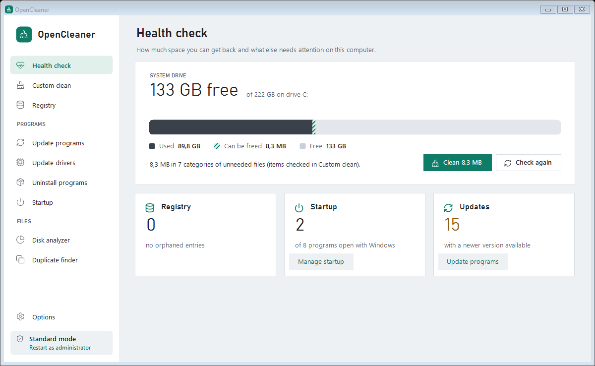
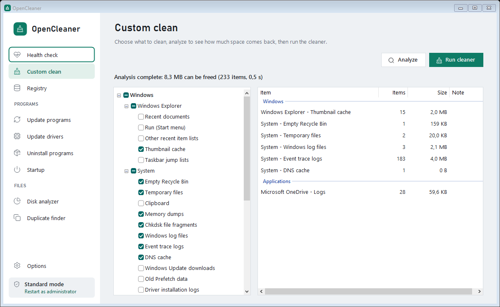
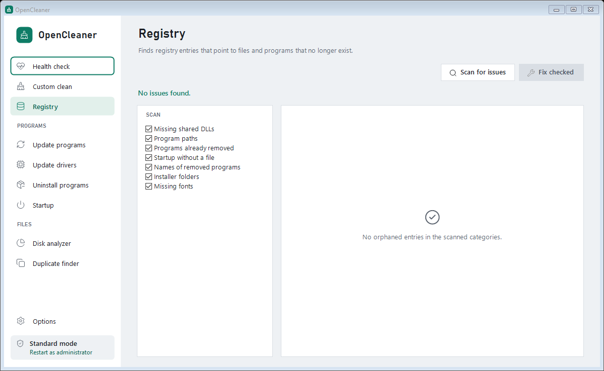
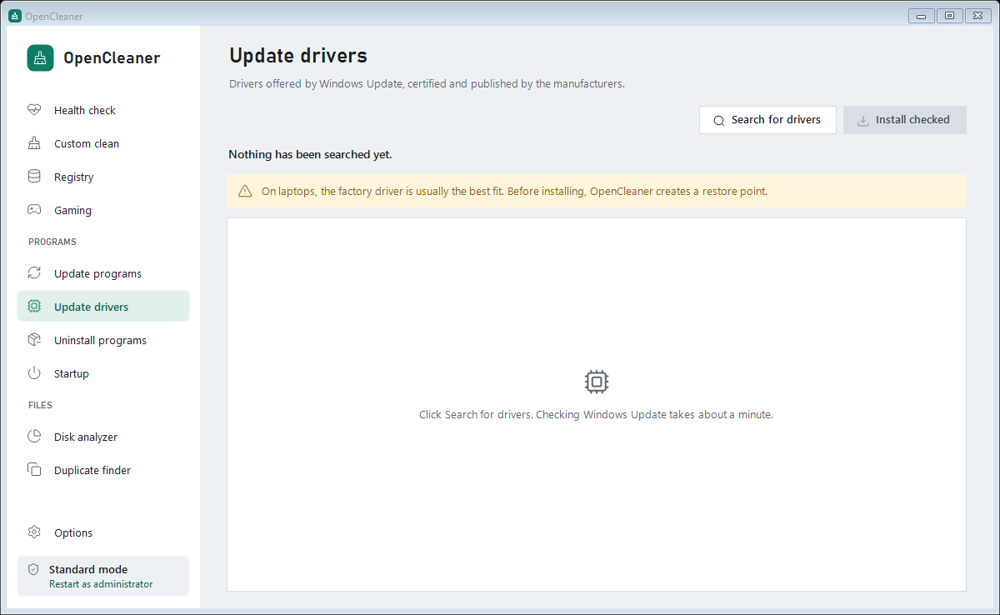

<div align="center">

**English** · [Português (Brasil)](README.pt-BR.md)


# OpenCleaner

**Free and open-source PC cleaner for Windows.**
Frees up disk space, cleans browsers, fixes the registry, updates programs and drivers and
manages startup, with no telemetry, no ads and no paid tier.

[](https://github.com/flavioricardo/OpenCleaner/releases/latest)
[](https://github.com/flavioricardo/OpenCleaner/releases)
[](https://github.com/flavioricardo/OpenCleaner/actions/workflows/build.yml)
[](LICENSE)


### [Download the installer](https://github.com/flavioricardo/OpenCleaner/releases/latest/download/OpenCleaner-Setup.exe) · [Portable version](https://github.com/flavioricardo/OpenCleaner/releases/latest/download/OpenCleaner-portable.zip) · [All releases](https://github.com/flavioricardo/OpenCleaner/releases)



[Features](#what-opencleaner-does) · [Permissions](#permissions-and-privacy) · [FAQ](#frequently-asked-questions)

</div>

---

## Contents

- [Why OpenCleaner](#why-opencleaner)
- [Download and install](#download-and-install)
- [What OpenCleaner does](#what-opencleaner-does)
- [What each action changes](#what-each-action-changes)
- [Permissions and privacy](#permissions-and-privacy)
- [Safeguards](#safeguards)
- [Command line and automatic cleaning](#command-line-and-automatic-cleaning)
- [Frequently asked questions](#frequently-asked-questions)
- [Inspiration and credits](#inspiration-and-credits)
- [Build from source](#build-from-source)
- [Contributing](#contributing)
- [License](#license)

## Why OpenCleaner

Popular PC cleaners have turned into subscription storefronts: "issues found" alerts to sell the paid
version, telemetry on by default, offers for other products during setup. OpenCleaner does the job of
a complete system cleaner and stops there:

- **Actually free**: no locked features, no subscription.
- **English and Portuguese**: the app and the installer follow the Windows language, and you can switch at any time.
- **No telemetry**: the app sends nothing about you or your PC.
- **Transparent**: the code is right here, and every cleaning item shows exactly which files will go.
- **Lightweight**: a single executable of about 230 KB, with no background service and no startup entry.
- **Careful**: analyzing never deletes anything; destructive actions ask for confirmation; passwords and cookies start unchecked.

## Download and install

| File | Who it's for |
|---|---|
| **[OpenCleaner-Setup.exe](https://github.com/flavioricardo/OpenCleaner/releases/latest/download/OpenCleaner-Setup.exe)** | Recommended. Installs for your user only, **without asking for administrator permission**, with a Start menu shortcut and uninstall from *Settings > Apps*. |
| [OpenCleaner-portable.zip](https://github.com/flavioricardo/OpenCleaner/releases/latest/download/OpenCleaner-portable.zip) | Portable: extract it and open `OpenCleaner.exe`. Good for a USB drive or for trying it without installing. |

**Requirements:** Windows 10 or Windows 11, 32 or 64-bit. The .NET Framework 4.x it needs already ships
with Windows. The program updater uses [winget](https://learn.microsoft.com/windows/package-manager/winget/)
(included in Windows 11 and in current versions of Windows 10).

**"Windows protected your PC":** the installer doesn't have a paid code-signing certificate yet, so
SmartScreen may warn you the first time. Click **More info** > **Run anyway**. To check that the file is
the one published here, compare its SHA-256 with the release's `SHA256SUMS.txt`:

```powershell
Get-FileHash .\OpenCleaner-Setup.exe -Algorithm SHA256
```

**Where it's installed:** `%LocalAppData%\Programs\OpenCleaner`. For a silent install (for example, on
several PCs), use `OpenCleaner-Setup.exe /S` (add `/LANG=en` or `/LANG=pt` to pick the language).

**Language:** the installer opens in the Windows language and has a *Português / English* selector in the
corner of the window. The choice also applies to the app and the uninstaller. Later, change it in
*Options > Idioma · Language*.

**Uninstall:** *Settings > Apps > OpenCleaner > Uninstall*. The uninstaller asks whether you want to keep
your settings and registry backups.

## What OpenCleaner does

### Health check

Your PC on one screen: how much of the system drive is used, how much **can be freed** (the hatched part
of the meter), orphaned registry entries, programs that open with Windows and programs with a newer
version available. The check only reads; nothing changes until you click **Clean**.

### Custom clean



More than 70 cleaning items grouped into **Windows**, **Browsers** and **Applications**. Only installed
programs show up. Click **Analyze** to see how much space comes back and double-click a result to see its
files; then click **Run cleaner**.

| Group | What it cleans |
|---|---|
| Windows: System | Recycle Bin, temporary files (with the option to keep files newer than 24 h), memory dumps, Chkdsk file fragments, Windows logs and event trace logs, Windows Error Reporting, DNS cache, Delivery Optimization, Windows Update downloads, old Prefetch data, GPU shader cache (DirectX, NVIDIA, AMD), driver installation logs, clipboard |
| Windows: Explorer | Thumbnail cache, recent documents, Run history, other recent item lists, taskbar jump lists |
| Browsers | **Google Chrome, Microsoft Edge, Brave, Vivaldi, Opera and Opera GX**: cache, browsing and download history, cookies, session, saved form data and saved passwords. **Mozilla Firefox**: cache, cookies, session, saved form data and crash reports |
| Applications | Discord, Microsoft Teams (classic and new), Zoom, Spotify, Visual Studio Code, Steam, OneDrive, Java, Telegram Desktop, NVIDIA installation files, 7-Zip history, Paint, Regedit and Remote Desktop |
| Advanced | **Custom folders**: any folder you set in *Options* |

With the community **`winapp2.ini`** file (the same format CCleaner accepts), OpenCleaner gets thousands
of extra rules: save it to `%AppData%\OpenCleaner\` and turn it on in *Options*.

### Registry



Finds entries that point to files and programs that no longer exist, in seven categories: missing shared
DLLs, program paths, programs already removed, startup without a file, names of removed programs,
installer folders and missing fonts. Before fixing, it offers a **`.reg` backup** you can restore with a
double-click.

### Update programs

Lists installed programs with a newer version and updates the checked ones through **winget**, the
official Windows package manager: Microsoft maintains the catalog and installers are hash-checked before
they run.

### Update drivers



Searches **Windows Update** for drivers (the same source as Windows *Optional updates*: drivers certified
and published by the manufacturers) and installs the ones you check, creating a **restore point** first.

### Tools

- **Uninstall programs**: list with icon, developer, date and size; search; opens the program's own
  uninstaller, opens the install folder, removes leftover entries of programs that were already deleted
  and exports the list to text.
- **Startup**: programs that open with Windows (registry and Startup folder, for the current user and for
  all users). **Disable** uses the same mechanism as Task Manager, so it can be undone.
- **Disk analyzer**: how much space each file type takes (images, music, videos, documents, archives,
  email, executables) and the largest files of each type.
- **Duplicate finder**: finds files with identical contents (size and MD5), checks the copies while keeping
  the oldest one, and sends them to the Recycle Bin.

## What each action changes

| Action | What happens | Can it be undone? | Needs administrator? |
|---|---|---|---|
| Analyze, Check now, Search, Scan | Read only. Nothing changes. | — | No |
| Run cleaner / Clean | Deletes the files of the checked items (directly, not through the Recycle Bin), empties the Recycle Bin, clears the DNS cache and clipboard, and removes recent item lists from the registry | No | Only for system folders (`C:\Windows\Temp`, Prefetch, Windows Update, Delivery Optimization); without permission those files are skipped |
| Fix checked (Registry) | Deletes the checked orphaned entries | Yes, with the `.reg` backup offered first | For system entries (HKLM) |
| Update checked (programs) | winget downloads and installs the new version of each checked program | Depends on the program | The program's installer may ask |
| Install checked (drivers) | Creates a restore point and installs the drivers through Windows Update | Yes, with System Restore or *Roll back driver* | Yes |
| Uninstall | Opens the program's own uninstaller | No | Depends on the program |
| Remove from list | Deletes the registry entry of a program that no longer exists | No | For programs installed for all users |
| Enable / Disable (startup) | Writes the same value Task Manager uses | Yes | For all-users items |
| Delete (startup) | Removes the item; shortcuts go to the Recycle Bin | Shortcuts, yes; registry items, no | For all-users items |
| Move to Recycle Bin (disk and duplicates) | Moves the chosen files to the Recycle Bin | Yes | No |

The app opens **without** asking for administrator rights. When an action needs them, it explains why and
offers *Restart as administrator*; the current mode shows at the bottom of the sidebar.

## Permissions and privacy

**What OpenCleaner reads on your PC:** the folders and registry keys of the cleaning items, the lists of
installed and startup programs, running processes (to warn you when a browser is open and locking files),
disk space, and the names of your Windows edition, processor and memory (shown in the Health check).

**What it writes:**

| Where | What |
|---|---|
| `%AppData%\OpenCleaner\OpenCleaner.ini` | Your item choices and options |
| `%AppData%\OpenCleaner\Backups\` | `.reg` backups you choose to save |
| `%AppData%\OpenCleaner\auto.log` | Results of automatic cleanings (`/AUTO`) |
| `%LocalAppData%\Programs\OpenCleaner\` | The app and the uninstaller (installer only) |
| Start menu and `HKCU\...\Uninstall\OpenCleaner` | The shortcut and the *Apps & features* entry (installer only) |

**Network:** OpenCleaner has no server, no account and no telemetry. It only goes online when you ask:
**Update programs** queries the winget catalog (Microsoft) and **Update drivers** queries Windows Update
(Microsoft). The app doesn't update itself or start with Windows.

## Safeguards

- Windows and user profile folders (Windows, System32, Program Files, Documents, Desktop, the profile root
  and others) are **never** wiped as a whole, not even by winapp2 rules.
- Junctions and symbolic links are not followed.
- Passwords, cookies, history and form data start **unchecked** and ask for confirmation when checked.
- Firefox history is not deleted, because it lives in the same file as your bookmarks.
- The registry cleaner only flags an entry when the file it refers to provably doesn't exist; network and
  relative paths are ignored.
- Duplicates and disk analyzer files go to the Recycle Bin and are never deleted directly.
- In *Options > Never delete*, you can protect any folder from every rule.
- Optional **secure deletion** overwrites each file with zeros before deleting it.

The threat model, every defense and the known limitations are in [SECURITY.md](SECURITY.md).

## Command line and automatic cleaning

| Command | Effect |
|---|---|
| `OpenCleaner.exe /AUTO` | Cleans in the background with the checked items, skips open programs and writes `auto.log` |
| `OpenCleaner-Setup.exe /S /LANG=en` | Silent install in English (`/LANG=pt` for Portuguese) |
| `uninstall.exe /uninstall /S` | Silent uninstall (`uninstall.exe` is in the install folder) |

To clean every week with Task Scheduler:

```bat
schtasks /create /tn "OpenCleaner weekly" /sc weekly /d SUN /st 12:00 ^
  /tr "\"%LocalAppData%\Programs\OpenCleaner\OpenCleaner.exe\" /AUTO"
```

## Frequently asked questions

**Is it safe to clean the registry?**
Orphaned entries don't slow Windows down; removing them is tidying up, not a performance boost. That's why
OpenCleaner is conservative: it only flags what provably points to nothing and offers a backup first. If
something goes wrong, double-click the saved `.reg` file to restore it.

**Will I lose my passwords or be signed out of websites?**
Not with the default selection. Cookies, passwords, form data and history start unchecked; when you check
them, the app explains what you'll lose.

**Why did it ask me to close my browser?**
Open browsers lock their cache files. You can let OpenCleaner close the program, skip its items or cancel.

**My antivirus or SmartScreen complained about the installer.**
New apps without a code-signing certificate often get this warning. The code is here, every release lists
the SHA-256 of each file, and the executable is built by GitHub Actions from this repository. You can also
[build it yourself](#build-from-source).

**Does it work offline?**
Yes. Only *Update programs* and *Update drivers* need a connection.

**How much space will I get back?**
It depends on how you use your PC: browser and app caches usually add up to hundreds of MB or a few GB.
The analysis shows the exact amount before anything is deleted.

**How is it different from CCleaner?**
OpenCleaner is completely free, open source and has no telemetry. It doesn't have CCleaner's performance
optimizer or free-space wiper, and it uses winget and Windows Update, Microsoft's official sources, to
update programs and drivers. The analysis of how CCleaner works that guided this project is in
[docs/ANALISE.md](docs/ANALISE.md) (in Portuguese).

**Does the app keep running in the background?**
No. It doesn't install a service, doesn't start with Windows and doesn't update itself. For automatic
cleaning, use Task Scheduler with `/AUTO`.

## Inspiration and credits

- **[CCleaner](https://www.ccleaner.com)**, by Piriform/Gen Digital: the reference for how the features are
  organized (Health check, Custom clean, Registry and Tools). OpenCleaner was written from scratch, with no
  CCleaner code, based on the behavior described in [docs/ANALISE.md](docs/ANALISE.md).
- **[BleachBit](https://www.bleachbit.org)**: proof that a cleaner can be free, open and respectful of its users.
- **[Winapp2](https://github.com/MoscaDotTo/Winapp2)**: the `winapp2.ini` rule format and the
  community-maintained list that OpenCleaner reads.
- **[Windows Package Manager (winget)](https://github.com/microsoft/winget-cli)** and **Windows Update**: the update sources.
- **[Lucide](https://lucide.dev)**: icons (ISC license).
- **Bahnschrift**, **Segoe UI** and **Consolas**: fonts that ship with Windows.

> OpenCleaner is an independent project, not affiliated with Piriform, Gen Digital, Avast or Microsoft.
> CCleaner is a registered trademark of Gen Digital Inc.

## Build from source

Nothing to install: the project uses the C# compiler (`csc.exe`) of the .NET Framework 4.x that ships with
Windows.

```powershell
git clone https://github.com/flavioricardo/OpenCleaner.git
cd OpenCleaner
powershell -ExecutionPolicy Bypass -File build.ps1                       # builds bin\OpenCleaner.exe
powershell -ExecutionPolicy Bypass -File installer\build-installer.ps1   # builds dist\ (installer, zip and SHA-256)
powershell -ExecutionPolicy Bypass -File tests\run-smoke.ps1             # smoke test
powershell -ExecutionPolicy Bypass -File tests\run-real.ps1              # real functional, security and performance tests
powershell -ExecutionPolicy Bypass -File tests\run-installer-tests.ps1   # installs, updates and uninstalls for real
```

The smoke test analyzes (without deleting) every detected rule, runs a real cleanup in a sandbox folder in
`%TEMP%`, checks the winget parser, renders every icon, scans the registry read-only, checks that both
languages keep the same rule IDs and saves screenshots of every screen in both languages. With `-Drivers`,
it also queries Windows Update.

`tests\run-real.ps1` runs every feature for real in a sandbox folder that mirrors each rule's locations,
creates registry and startup entries named `OpenCleanerTest` (removed at the end), attacks the engine
(junction swaps, hard links, malicious rules, planted DLLs) and measures performance on the real disk,
read-only. `tests\run-installer-tests.ps1` installs, updates with the app open and uninstalls for real,
keeping your settings.

`tests
un-real.ps1` runs every feature for real in a sandbox folder that mirrors each rule's locations,
creates registry and startup entries named `OpenCleanerTest` (removed at the end), attacks the engine
(junction swaps, hard links, malicious rules, planted DLLs) and measures performance on the real disk,
read-only. `tests
un-installer-tests.ps1` installs, updates with the app open and uninstalls for real,
keeping your settings.

```
src/Core/       engine: rules (winapp2 format), cleaning, registry, updaters, tools, settings, languages
src/UI/         WinForms interface and the Lucide icon renderer
rules/          builtin.ini: the built-in cleaning rules, as text (Portuguese and English)
installer/      per-user installer (Setup.cs) and the distribution script
assets/         app icon and Lucide SVG icons
tests/          smoke test
docs/           CCleaner analysis and screenshots
```

**Translations:** interface text sits next to its translation in the code, as `L.T("Portuguese", "English")`;
cleaning rules use `Item=`/`ItemEn=`, `Group=`/`GroupEn=` and `Warning=`/`WarningEn=` in `rules/builtin.ini`.

**Releasing a version:** update the version in `src/Program.cs` and `CHANGELOG.md`, then create and push
the tag. GitHub Actions builds and publishes the release with the installer, the zip and `SHA256SUMS.txt`.

```bash
git tag -a v1.0.1 -m "OpenCleaner 1.0.1" && git push origin main --follow-tags
```

### Visual identity

| Token | Color | Use |
|---|---|---|
| Mist | `#EEF1F4` | page background |
| Paper | `#FFFFFF` | sidebar, cards and lists |
| Ink | `#1B1F24` | text |
| Graphite | `#5B636E` | secondary text (5.4:1 contrast on Mist) |
| Clean green | `#0E7C66` | primary action and selection (5.1:1 with white) |
| Slate | `#3A414B` | used space in the meter |
| Amber | `#8A5A12` on `#FFF4DC` | warnings |

Headings and numbers in **Bahnschrift**, body text in **Segoe UI**, paths and keys in **Consolas**. Every
page follows the same layout: title, action bar (primary action on the far right), status line and content
with an empty state that tells you what to do.

## Contributing

Suggestions and fixes are welcome in [Issues](https://github.com/flavioricardo/OpenCleaner/issues).

- **New cleaning rule:** edit [`rules/builtin.ini`](rules/builtin.ini). The format is winapp2's (`FileKey`,
  `RegKey`, `Detect`, `ExcludeKey`) plus a few extra keys explained at the top of the file. Say where each
  path comes from and why it's safe to delete, and add the English name (`ItemEn=`).
- **Bug:** tell us your Windows version, what you did, what you expected and what happened.
- Before opening a pull request, run `tests\run-smoke.ps1`.

## License

[MIT](LICENSE). Lucide icons under the ISC license ([assets/icons/LICENSE](assets/icons/LICENSE)).
